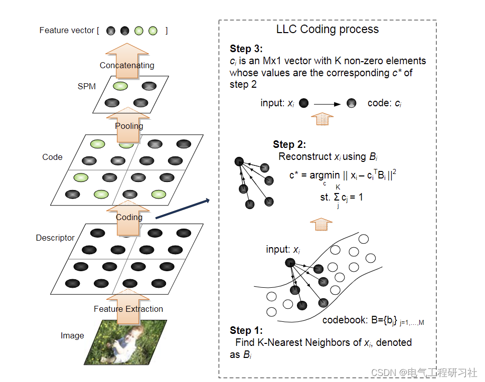
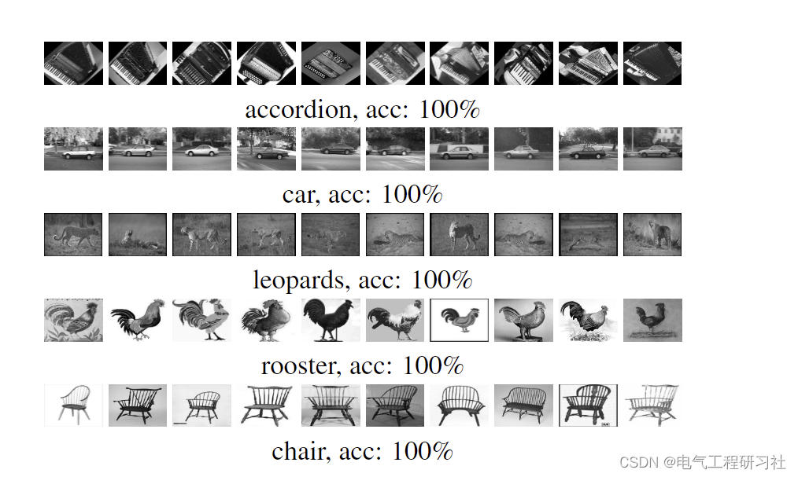
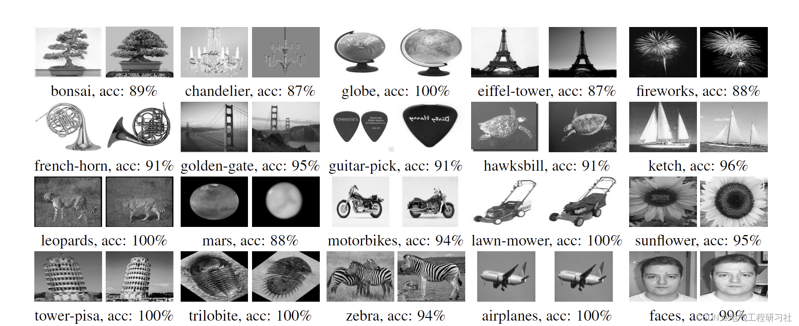
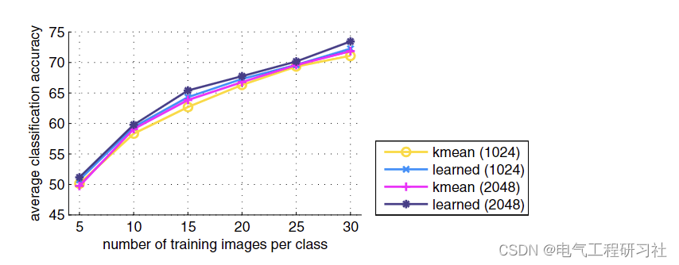
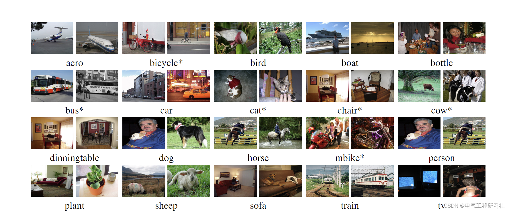

# [Image Processing]Locally Constrained Linear Coding for Image Classification (Python Code Implementation)

1. Overview
Trained classification models can accurately identify specific objects in images, identifying "what is in the image," but research on image classification problems involving abstract concept labels such as "what is described in the image" is less common and more challenging. Abstract concept labels do not belong to any specific object contained in an image but are mixed together by many different concepts, making it difficult to directly learn this abstract label. To address this issue of image classification for abstract concept labels, a multi-example learning approach was utilized to design and implement a multi-example two-stage model.
His most recent state-of-the-art image classification system consists of two main components: the Bag of Features (BoF) [19, 4] and the Spatial Pyramid Matching (SPM) [15]. The BoF method represents an image as a histogram of its local features. It is robust to spatial transformations of features and performs well in full-image classification tasks. However, the BoF method ignores information about the feature space layout, thus failing to capture shape or locate objects. Although traditional SPM methods have shown good performance in image classification, empirical observations suggest that for good performance, traditional SPM requires a classifier with a non-linear Mercer kernel, such as the chi-square kernel. Therefore, non-linear classifiers must provide additional computational complexity, bearing O(n3) in training and O(n) in SVM, where n is the number of support vectors. This means that SPM methods have poor scalability for real-world applications.
The traditional SPM method based on Feature-based Packaging (BoF) requires a nonlinear classifier to achieve good image classification performance. This paper proposes a simple but effective encoding scheme called Locally Constrained Linear Coding (LLC), replacing the VQ encoding in the traditional SPM. LLC utilizes locality constraints to project each descriptor into its local coordinate system, and integrates the projection coordinates through max pooling to generate the final representation. Using a linear classifier, the proposed method significantly outperforms the traditional nonlinear SPM in multiple benchmark tests, achieving state-of-the-art performance. Compared with sparse coding strategies [22], the objective function used by LLC has a closed-form solution. Moreover, this paper presents a fast approximation method for LLC, which first performs K-nearest neighbor search and then solves the constrained least squares fitting problem, with computational complexity of O(M + K^2). Therefore, even with a very large codebook, our system can still process multiple frames per second. This efficiency significantly increases the practical value of LLC in real applications. For detailed reading: Locality-constrained linear coding for image classification | IEEE conference publication | IEEE Xplore Editor
2 Mathematical Models
See: Locality-constrained linear encoding for image classification | IEEE conference publication | IEEE Xplore
3 Experimental Results In this section, we report results based on three widely used datasets: Caltech-101 [7], Caltech-256 [11], and Pascal VOC 2007 [6]. During the entire experiment, we only utilized one descriptor, namely the Oriented Gradient Histogram (HOG) [5]. In our setup, HOG features are extracted from blocks densely located at every 8 pixels over the image, at three scales of 16×16, 25×25, and 31×31. Each HOG descriptor has a dimension of 128. During the LLC processing, only an approximate LLC was used, with a neighbor count set to 5 (Section 3), and with shift invariant constraints. In the "SPM" layer, for each spatial subregion.
Editor
Editor
Example image from the category with the highest classification accuracy in Caltech-256 data.
Editor
Editor
4. Python code implementation
import numpy as np\nimport numpy.linalg\nimport math\nimport os.path\nfrom LLC_coding_appr import LLC_coding_appr\n\ndef LLC_pooling(B,X,pyramid,knn,img_width,img_height,X1,Y):\n    dSize = B.shape[1]\n    nSmp = X.shape[1]\n    \n    idxBin = np.transpose(np.zeros(nSmp))\n  
​  

## Images

<!-- PAYMENT_BLOCK -->

## Get this dataset

- Payment link (Stripe): [Buy now](https://buy.stripe.com/3cs8yP7sY87d0vu9AB)
- Payment QR code: 

<!-- /PAYMENT_BLOCK -->
